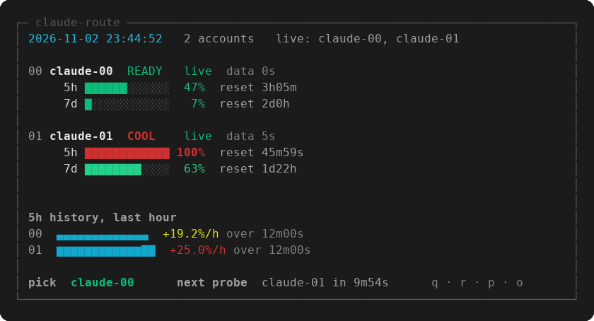

# claude-route

[](https://github.com/Valdemar-Yu/claude-route/actions/workflows/ci.yml)

一套 Claude Code 多账号路由方案，外加一个不烧额度的额度看板。

一套 Claude Code，可以对接多个官方订阅轮换使用，也可以把请求转给 DeepSeek 之类的兼容后端；`claude-route` 负责其中的账号隔离、切换和额度可见性。

macOS 是主要开发和验证平台，Windows、Linux 同样支持。下文默认 macOS 的 zsh/bash，Windows 的写法放在每节后面的补充里。



<sub>截图由 `tools/make_screenshot.py` 从当前代码生成，数据是脚本里造的样例，不含真实账号信息。</sub>

## 它解决什么

一个 Claude 订阅有 5 小时和 7 天两层额度，打满之后要么等，要么换号。开两个号不难，难的是三件事：

1. 两个号要真正隔离，不能共用同一个 `~/.claude` 目录互相串登录态；
2. 得随时知道哪个号还能用、还剩多少、什么时候重置；
3. 查看额度这件事本身不能消耗额度。

前两条由上游 [claude-accounts](https://github.com/claude-code-tools/claude-code-account-switcher) 负责：它把每个订阅的 OAuth token 和 config 目录分开存，`claude-accounts launch 00` 就是另一个号的独立会话。

第三条是 `claude-route` 的全部工作。它读 claude-accounts 已经写好的用量缓存，1 秒重绘一次界面；只有在缓存过期时才去问一次官方接口，并且严格卡住频率。

## 三条路由

| 组合 | 前端 | 背后是什么 | 什么时候用 |
|---|---|---|---|
| 官方订阅池 | Claude Code | 多个 Claude 订阅轮换 | 主力，额度就是你的成本上限 |
| Claude Code + DeepSeek | Claude Code | `api.deepseek.com/anthropic` | 批量、长尾、机械活，按 token 付费，不占订阅额度 |
| Hermes + Codex | Hermes / Codex CLI | 另一套 agent 运行时 | 想换执行者或跨模型交叉验证时 |

DeepSeek 官方提供 Anthropic 兼容端点，`claude-opus*` 映射到 `deepseek-v4-pro`，`claude-sonnet*` / `claude-haiku*` 映射到 `deepseek-flash`，所以 Claude Code 只改两个环境变量就能切过去。macOS/Linux 的 zsh/bash：

```bash
export ANTHROPIC_BASE_URL="https://api.deepseek.com/anthropic"
export ANTHROPIC_API_KEY="sk-..."
claude
```

Windows PowerShell：

```powershell
$env:ANTHROPIC_BASE_URL = "https://api.deepseek.com/anthropic"
$env:ANTHROPIC_API_KEY  = "sk-..."
claude
```

细节和另外两条路由的配法见 [docs/routes.md](docs/routes.md)。

## 可选：Baton 编排

如果一次要做的是十几个文件、几十轮的工具调用，单会话会顶到 5 小时额度。可行的做法是在外面套一层编排，把任务拆给多个执行者，每个执行者跑在独立的订阅上，`claude-route` 负责盯着它们别把池子抽干。

Baton 就是作者在用的那层编排：conductor 决策、monitor 监督、executor 执行，执行者按任务分发到不同后端。`claude-route` 不依赖它，也不包含它；这里只说明接入点：把每个 executor 的 `CLAUDE_CONFIG_DIR` 指向 claude-accounts 里不同的账号目录，再把 `claude-route --json` 接进编排器的调度判断，就能按额度余量分配任务。

## 安装

要求 Python 3.10+ 和上游 [claude-accounts](https://github.com/claude-code-tools/claude-code-account-switcher)。下面按 macOS 的顺序写，Windows 的等价写法在本节最后。

### 1. 安装 claude-accounts

claude-accounts 是 Go 程序。macOS 上用上游的安装脚本，它会按 OS 和架构下载预编译二进制，装进 PATH 上的可写目录（默认 `~/.local/bin`），不改 `.zshrc` / `.bashrc`。当前版本是 `v1.0.0`，更新的版本去 [release 页](https://github.com/claude-code-tools/claude-code-account-switcher/releases) 看，把命令里的版本号换掉：

```bash
curl -fsSL https://raw.githubusercontent.com/claude-code-tools/claude-code-account-switcher/v1.0.0/install.sh | sh
claude-accounts list
```

`~/.local/bin` 要在 PATH 上（脚本不会改 shell 配置）。macOS 默认的 zsh 不带这个目录，在 `~/.zshrc` 里加一行，然后开新终端：

```bash
export PATH="$HOME/.local/bin:$PATH"
```

`claude-accounts list` 能跑起来就算装好了，还没有账号时是空列表。

要装到别的目录，在 `sh` 前面设 `CLAUDE_ACCOUNTS_BIN_DIR`：

```bash
curl -fsSL https://raw.githubusercontent.com/claude-code-tools/claude-code-account-switcher/v1.0.0/install.sh | CLAUDE_ACCOUNTS_BIN_DIR="$HOME/bin" sh
```

不想用安装脚本，也可以手动下 release 包。Apple Silicon 用 `darwin_arm64`，Intel 用 `darwin_amd64`，包里顶层就是一个 `claude-accounts` 文件：

```bash
VERSION=v1.0.0
ARCH=darwin_arm64        # Intel 用 darwin_amd64
mkdir -p ~/.local/bin /tmp/claude-accounts-dl
curl -fL -o /tmp/claude-accounts.tar.gz \
  "https://github.com/claude-code-tools/claude-code-account-switcher/releases/download/$VERSION/claude-accounts_${VERSION}_${ARCH}.tar.gz"
tar xzf /tmp/claude-accounts.tar.gz -C /tmp/claude-accounts-dl
install -m 755 /tmp/claude-accounts-dl/claude-accounts ~/.local/bin/claude-accounts
claude-accounts list
```

### 2. 安装 claude-route

Xcode Command Line Tools 自带的 `python3` 可能是 3.9，低于项目要求的 3.10，直接 `python -m pip install -e .` 可能卡在版本检查上。推荐用 uv 装到独立的工具环境：

```bash
git clone https://github.com/Valdemar-Yu/claude-route.git
cd claude-route
curl -LsSf https://astral.sh/uv/install.sh | sh
uv tool install -e .
```

`uv tool install` 会把 `claude-route` 和 `claudepool` 两个等价命令装进 `~/.local/bin`，和上一步在同一个 PATH 上。

不想用 uv 的话，用 3.10+ 的解释器建 venv，`python3.12` 换成你机器上装好的版本：

```bash
python3.12 -m venv .venv
. .venv/bin/activate
python -m pip install -e .
```

### 3. 添加账号

`claude-accounts add` 会让你给账号起名字和命令后缀，后缀用来自定义启动命令。上游的例子是 `claude-gmail`、`claude-naver`；下面用 `00`、`01` 当后缀，填什么由你定：

```bash
claude-accounts add        # 跑一遍 claude setup-token，走浏览器授权，后缀填 00
claude-accounts add        # 再加一个，后缀填 01
claude-accounts list
```

`add` 会调用 `claude setup-token`，拿到的 token 存进登录 Keychain。

`claude-<后缀>` 启动器是指向 `claude-accounts` 的软链接，放在它旁边，但 `claude-accounts add` 子命令不会创建它们，只有不带参数运行 `claude-accounts`（交互式管理器）时才会补齐。所以加完账号后运行一次，看到账号列表就退出（数字菜单输入 `0`，装了 fzf 时按 Esc）：

```bash
claude-accounts            # 进入管理器即会创建 claude-00、claude-01，然后退出
rehash                     # zsh 刷新命令缓存，或者开新终端
```

启动会话：

```bash
claude-00                  # 等价于 claude-accounts launch 00
claude-01
```

只有经 `claude-accounts launch <slug>` 或 `claude-<slug>` 启动的会话才会自动挂上 statusline（`--settings <root>/usage-settings.json`），这里的 slug 就是 `add` 时填的后缀；会话运行期间，每次 statusline 刷新都会写一次 `<root>/usage/<slug>.json`。在别处直接敲 `claude` 不会更新这个文件，看板上的数字就停在旧值。

开一个会话之后，在另一个终端里跑看板：

```bash
claude-route
```

### Windows

Windows 上装 claude-route 用 pip，Python 同样要 3.10+：

```powershell
git clone https://github.com/Valdemar-Yu/claude-route.git
cd claude-route
python -m pip install -e .
```

不装也能跑，仓库里带了免安装入口：

```powershell
.\bin\claude-route.cmd --once
```

claude-accounts 在 Windows 上按上游 README 安装，确认 `claude-accounts list` 可用即可。Windows 和 Linux 的 token 存在 claude-accounts 根目录的 `tokens.json`，macOS 存在登录 Keychain，`claude-route` 两种都只读。

## 使用

```bash
claude-route                # 进入 TUI，1 秒刷新
claude-route --once         # 打印一屏快照
claude-route --json         # 机器可读，给编排器或状态栏用
claude-route --offline      # 只读缓存，一个包都不发
claude-route --probe --once # 立刻探一次官方接口（受冷却限制）
```

| 按键 | 作用 |
|---|---|
| `q` | 退出 |
| `r` | 立刻探测一次，受 45 分钟冷却约束 |
| `p` | 暂停刷新 |
| `o` | 切换离线/在线 |

| 参数 | 说明 |
|---|---|
| `--base` | claude-accounts 的数据目录；优先使用 `CLAUDE_SUBSCRIPTIONS_DIR`，否则是 `${XDG_CONFIG_HOME:-~/.config}/claude-subscriptions`。Windows 上同样先看 `CLAUDE_SUBSCRIPTIONS_DIR` 和 `XDG_CONFIG_HOME`，都没有则是 `%USERPROFILE%\.config\claude-subscriptions` |
| `--state-dir` | 探测状态和历史的位置；macOS/Linux 默认 `${XDG_STATE_HOME:-~/.local/state}/claude-route`，Windows 默认 `%LOCALAPPDATA%\claude-route`。若新目录不存在而旧的 `claude-pool-monitor` 存在，会继续使用旧目录 |
| `--interval` | 重绘间隔，默认 1 秒 |

## 读数说明

| 字段 | 含义 |
|---|---|
| `5h` / `7d` | 官方百分比。绿 <50%，黄 ≥80%，红 =100% |
| `resets` | 距离重置的时间。窗口已过期显示 `reset`，百分比带 `~` 表示按归零推算 |
| `data` | 缓存年龄。≤90 秒是绿色，说明该账号正在跑会话；黄色 10 分钟，红色 1 小时 |
| `state` | `READY` / `TIGHT` / `COOL`（5h 打满）/ `UNKNOWN` |
| `history` | 最近一小时的 5h 采样曲线和烧号速率，速率标注统计跨度 |
| `pick` | 5h 最低、7d 未满的账号，即下一个该用的 |

## 为什么不烧额度

`GET /api/oauth/usage` 是唯一能查到官方百分比的入口，但它按小时限流。实测两次都是 429，`Retry-After` 分别给过 3600 和 1014 秒，说明冷却时间是滑动的。

所以主数据源不是接口，而是 claude-accounts 的 statusline 钩子已经写好的文件：

```
Claude Code 会话
   └─ statusline 每 15 秒被调用一次，stdin 里带着 rate_limits
        └─ claude-accounts statusline 落盘到 usage/<slug>.json
             └─ claude-route 每 1 秒读这个文件，零请求
```

接口只在缓存超过 10 分钟没更新时才兜底，每个账号 45 分钟最多一次，全局错峰 90 秒，收到 429 就把 `Retry-After` 记进状态文件，到点前完全静默。两条路径都不产生推理请求，不消耗 5h/7d 额度。实测记录见 [docs/rate-limits.md](docs/rate-limits.md)。

兜底探测有一个前提：token 要带 `user:profile` 权限。`claude-accounts add` 存的是 `claude setup-token` 生成的一年期 token，只有推理权限，接口会回 403 `oauth_scope_insufficient`。这时 claude-route 把该账号标记为只读缓存，24 小时内不再探测，界面上写明原因。所以用 claude-accounts 管理的账号，数字全部来自正在运行的会话：账号至少要用 `claude-<后缀>` 开过一次会话，看板才有数据。

## 边界

- 只读。claude-route 不写 claude-accounts 的 `accounts.tsv`、`tokens.json`、`usage/` 或 `configs/`，也不写 Keychain，探测结果存在自己的状态目录。
- macOS 上 token 从登录 Keychain 读，走 `/usr/bin/security find-generic-password -a $USER -s <service> -w`；Windows 和 Linux 读 claude-accounts 根目录的 `tokens.json`。两条路径都只读。
- 没有活会话的账号，数字会停在最后一次缓存上；`data` 列变红就是在提示这件事。
- 429 是账号或出口 IP 级别的，两个账号曾经同时被限。探测预算是全局算的，不是每个账号各算一份。
- macOS、Linux 和 Windows 都支持 TUI 交互键；没有终端（例如管道或重定向）时不读键。
- 上游 claude-accounts 的二进制不在此仓库内，本仓库不打包、不修改它。

## License

MIT。上游 claude-accounts 遵循其各自的许可。

---

**English**

`claude-route` is a small companion for [claude-accounts](https://github.com/claude-code-tools/claude-code-account-switcher): a 1 Hz terminal dashboard for every subscription's 5h / 7d quota that never spends any of it. It reads the usage cache claude-accounts already writes from Claude Code's statusline, and only falls back to the official usage endpoint once every 45 minutes per account, honouring `Retry-After`. It also documents routing the same Claude Code install to DeepSeek's Anthropic-compatible endpoint, and to Hermes / Codex, for work that should not touch subscription quota at all.

macOS is the primary platform; Windows and Linux are supported the same way. Install claude-accounts with the upstream `install.sh`, which downloads the prebuilt binary for your OS and architecture, then `uv tool install -e .` for claude-route. On macOS the account tokens live in the login Keychain and are only read; on Windows and Linux they are in `tokens.json` under the claude-accounts root. The TUI accepts interactive keys on all three platforms and leaves piped or redirected stdin untouched.
